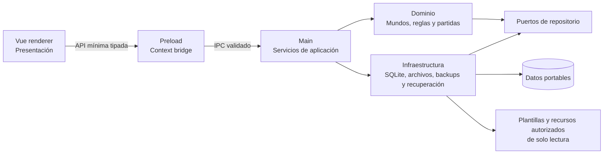

# Arquitectura de Fatebound 2.0

Estado del documento: arquitectura aprobada con Electron 44.7.0, almacenamiento SQLite, shell visual, empaquetado portable, contrato/validador `.fateworld` v1 y incorporación segura a la bandeja implementados; la instalación de mundos, el dominio jugable y el motor continúan pendientes.

Última actualización: 2026-10-14.

Este documento describe la dirección aprobada para Fatebound y marca expresamente lo que todavía no existe. La única tabla actual controla migraciones; no se ha definido el esquema SQL del juego ni se consideran implementados los demás subsistemas propuestos. La especificación normativa de paquetes v1 se mantiene en [WORLD_FORMAT.md](WORLD_FORMAT.md) y la dirección de interfaz en [DESIGN_SYSTEM.md](DESIGN_SYSTEM.md).

## 1. Punto de partida real

El repositorio contiene actualmente:

- un proceso main que crea una ventana, gestiona el ciclo de vida y atiende diagnóstico, exportación y restauración SQLite;
- un preload restringido que expone únicamente contratos específicos de diagnóstico, exportación, restauración y preferencias;
- un renderer Vue con shell de Fatebound, identidad base y nueve temas YAML integrados con ilustraciones empaquetadas;
- Electron 44.7.0 y `@types/node` 24.19.2 fijados en versiones exactas, junto con TypeScript estricto, ESLint, Prettier, electron-vite y electron-builder;
- recursos de marca y 36 imágenes de combinaciones de dados para los clanes de Ronin;
- un target `portable` x64 de electron-builder que genera `dist/Fatebound.exe` sin instalador obligatorio;
- un empaquetado público con lista explícita de recursos propios; la variante privada todavía no está configurada;
- un resolvedor central, una comprobación de escritura y una conexión SQLite ejecutados en main antes de crear la ventana principal;
- migraciones SQL versionadas y transaccionales con una única migración técnica inicial;
- integridad, copias previas a migraciones o restauraciones, copias automáticas, retención segura, exportación y restauración manual ejecutadas exclusivamente en main;
- un servicio interno de main que valida paquetes `.fateworld` v1 sin extraerlos ni instalarlos, más una muestra técnica original reproducible.

No están implementados el esquema de persistencia del juego, los repositorios del dominio, los mundos jugables, el instalador persistente, el editor, el motor de reglas, las campañas, las crónicas ni la integración de IA. La incorporación actual termina en la bandeja externa. Las tarjetas de mundos y los estados futuros de la shell son demostraciones de presentación, no datos instalados. El validador v1 tampoco convierte la muestra técnica en contenido jugable.

## 2. Principios

- **Local primero:** jugar no requiere servidor ni conexión a Internet.
- **Portable:** los datos mutables se resuelven junto a la distribución portable y pueden viajar con ella.
- **Fronteras explícitas:** renderer, preload, main, dominio e infraestructura tienen responsabilidades separadas.
- **Contenido no confiable:** Markdown, metadatos e imágenes importados son datos que deben validarse; nunca se ejecutan.
- **Distribución responsable:** la compilación pública puede funcionar sin mundos y no incorpora contenido protegido de terceros sin autorización.
- **Versiones inmutables:** una versión publicada no se edita; una modificación genera una versión derivada.
- **Experiencia de aventura:** la interfaz sigue la dirección «RPG cinematográfico + diario de aventuras» y no presenta el juego como un dashboard técnico.
- **Tema sin privilegios:** un mundo puede transformar la atmósfera mediante datos y recursos declarativos validados, nunca mediante código o acceso nativo.
- **Compatibilidad acumulativa:** ampliar el motor no rompe mundos ni partidas anteriores sin una estrategia explícita de compatibilidad y migración.
- **Trazabilidad:** las acciones relevantes de una partida producen eventos utilizables en una crónica.
- **Control del jugador:** una IA opcional puede proponer, pero no modificar reglas ni estado de juego sin confirmación.

## 3. Capas propuestas



### 3.1 Renderer — presentación

Vue representa vistas, formularios y estados de interacción. Puede solicitar operaciones mediante la API del preload, pero no recibe consultas SQL, módulos de Node ni acceso general a rutas. El diagnóstico presenta las rutas activas de datos y base sin permitir elegir, recorrer, leer ni modificar otros archivos. Exportación y restauración solicitan que main abra el selector del sistema, sin enviar o recibir la ruta seleccionada. Mundos solicita un catálogo sin argumentos y recibe solo identidad, versión, títulos, idiomas, nombre base del archivo e incidencias sanitizadas. Las respuestas son DTO tipados y sin detalles internos innecesarios.

**Implementado:** la demo de electron-vite se ha sustituido por una shell que separa navegación global y contextual. La marca completa es el acceso a Inicio, Ajustes es un botón de cabecera y el menú lateral contiene solo Mundos mientras no exista un mundo jugable instalado y activo. La estructura admite Mundos, Personajes y Crónicas cuando reciba en el futuro un contexto real con identificador y versión. El arranque usa `fatebound` como identidad visual neutral, no como mundo del catálogo. Ronin, Templario, Ninja, Shaolin, Robot, Soldado, Naves y Mundoplato pueden cambiar la ambientación durante la sesión, pero no instalan mundos ni amplían la navegación.

### 3.2 Preload — frontera nativa

**Implementado:** el preload ya no expone `@electron-toolkit/preload` ni `ipcRenderer`. Ofrece únicamente operaciones fijas de diagnóstico, exportación, selección/confirmación/cancelación de restauración, preferencia de idioma, consulta del catálogo e incorporación de un paquete de mundo. Ninguna acepta una ruta desde el renderer: main conserva los destinos, selecciones y la bandeja `worlds/`. La vista previa de restauración devuelve solo fecha, motivo, versión de esquema y tamaño; los contratos de mundos devuelven datos normalizados y resultados sin rutas absolutas, trazas ni mensajes internos. Los contratos compartidos son tipados, el idioma se valida tanto en preload como en main y no existen primitivas generales de archivos, SQL ni acceso a la conexión SQLite.

### 3.3 Main — aplicación

El proceso main ya es dueño de la resolución de rutas, la comprobación de escritura, la conexión SQLite, sus migraciones, su cierre y el flujo nativo de recuperación. También será dueño de:

- validación de solicitudes IPC;
- casos de uso y transacciones;
- lectura y escritura de archivos;
- importación, exportación y copias de seguridad;
- coordinación del motor de reglas.

Los handlers IPC delegan en servicios de aplicación; no contienen reglas de negocio ni consultas dispersas. El handler de diagnóstico registra el error técnico en main y devuelve al renderer solo un código conocido; el renderer localiza el mensaje sin recibir excepciones internas.

### 3.4 Dominio

El dominio modelará mundos, versiones, técnicas, efectos, personajes, clanes, crónicas y eventos sin depender de Electron, Vue o SQLite. Sus invariantes incluyen la inmutabilidad de versiones publicadas y la asociación de cada personaje y crónica a una versión concreta de mundo.

### 3.5 Infraestructura

La infraestructura inicial implementa el ciclo de vida de SQLite y sus migraciones sin depender del renderer. Adaptadores concretos implementarán repositorios SQLite, almacenes de recursos, importación Markdown y exportación. Las dependencias apuntan hacia contratos del dominio o la aplicación, de modo que puedan probarse sin abrir una ventana de Electron.

Las capas de dominio y repositorios continúan siendo propuestas. La frontera de procesos, el resolvedor portable, la validación previa de escritura y la base SQLite inicial ya están implementados.

### 3.6 Sistema visual

La presentación se divide en una shell estable de Fatebound, un tema declarativo y contenido narrativo. **La primera capa ya está implementada:** la shell conserva navegación, estados, foco, contraste y disposición adaptativa. Los nueve temas de solo lectura se originan en `resources/builtin-themes/<id>/theme.yaml`: Fatebound aporta la identidad base y los otros ocho representan mundos futuros. No proceden de paquetes instalados, no se registran en SQLite y no son mundos jugables.

`builtin-theme-schema.ts` analiza un subconjunto deliberadamente pequeño de YAML: mapas, escalares conocidos y un esquema exacto, sin etiquetas, anclas, alias, colecciones libres ni campos adicionales. Valida `schemaVersion`, estado integrado no jugable, identificador permitido, colores `#RRGGBB`, opciones controladas y rutas de imagen específicas bajo `assets/`. Los YAML no contienen textos de presentación: nombres, lemas, categorías, descripciones y atmósferas se resuelven en el catálogo i18n mediante el identificador estable. Se rechazan rutas absolutas, separadores de Windows, `..`, consultas y nombres no previstos.

Cada definición puede declarar `hero.webp`, `card.webp` o `card.png` y `emblem.png`. El cargador resuelve solo los archivos realmente empaquetados y registra por rol cualquier ausencia; la vista sustituye ese recurso por un fallback local sin invalidar los demás. Inicio usa la ilustración `hero` bajo superposiciones de contraste. Mundos respeta la proporción vertical 3:4 de las tarjetas y reserva el panel inferior para un emblema protagonista sobre un degradado discreto, sin reutilizar allí el `hero`. El logo oficial permanece separado. Los paneles técnicos de Ajustes conservan superficies neutrales y emplean el acento activo con contención.

Legibilidad, sesiones largas, navegación clara, reducción de movimiento y adaptación al tamaño de ventana son restricciones arquitectónicas de la interfaz, no detalles ornamentales. Las ocho tarjetas integradas se etiquetan **Próximamente** hasta que el catálogo detecta un paquete con el ID estable reservado correspondiente; entonces muestran **Paquete disponible** sin presentarlo como instalado ni jugable. Los demás IDs válidos aparecen como entradas adicionales neutrales, sin sustituir ilustraciones oficiales. **Instalado** permanece como un estado separado que esta etapa no produce. La selección temática continúa durante la sesión, sobrevive a la navegación entre secciones, puede volver explícitamente a Fatebound neutral y no se persiste. El acceso a Personajes y Crónicas depende exclusivamente de un futuro mundo instalado activo, nunca de un paquete detectado o del tema visual. Este esquema interno prepara conceptos reutilizables, pero no forma parte del contrato visual `.fateworld` v1 ni define todavía temas de paquete.

### 3.7 Internacionalización y preferencias

**Implementado, pendiente de verificación manual:** un catálogo ligero propio en `src/shared/i18n/` ofrece claves tipadas y archivos independientes para español, inglés y coreano, con español como idioma inicial y fallback explícito. El renderer conserva el idioma en estado reactivo, actualiza `document.lang`, usa `Intl.DateTimeFormat` con `es-ES`, `en-GB` o `ko-KR` y cambia los textos sin reiniciar ni alterar navegación o tema. Los diálogos nativos usan el mismo catálogo cuando el almacenamiento permite leer la preferencia.

Main guarda `{ schemaVersion, applicationLanguage }` en `data/preferences.json`. La escritura usa un temporal exclusivo, sincronización y renombrado; un fallo conserva el archivo anterior. El IPC solo admite `es`, `en` o `ko`, vuelve a validarlos en main y devuelve resultados explícitos de lectura y guardado. Este archivo no forma parte de SQLite ni activa copias de la base.

El idioma de aplicación es independiente del futuro idioma de contenido. Cada `.fateworld` declarará su idioma predeterminado y solo los idiomas realmente incluidos; si el idioma de interfaz no existe en un mundo, la futura biblioteca usará el predeterminado del paquete e informará al jugador. El catálogo integrado actual traduce únicamente su presentación artística y no afirma que existan contenidos jugables multilingües.

## 4. Datos portables y SQLite

### 4.1 Resolución de rutas

**Implementado:** `src/main/storage/portable-storage.ts` es la fuente central de rutas. Recibe el contexto de ejecución y produce rutas absolutas resueltas en tiempo de ejecución, sin codificar una letra de unidad ni una ubicación específica de un ordenador.

- En desarrollo usa `<appPath>/.fatebound-dev/data/`, una ubicación local ignorada por Git e independiente de instalaciones reales.
- La bandeja de entrada de paquetes se resuelve por separado: `<appPath>/.fatebound-dev/worlds/` en desarrollo y `worlds/` junto al ejecutable portable en distribución. No sigue una carpeta de datos alternativa elegida para la sesión y nunca depende de `process.cwd()`.
- En una aplicación empaquetada prefiere el directorio indicado por `PORTABLE_EXECUTABLE_DIR`. El launcher portable de electron-builder establece esa variable con `$EXEDIR`, el directorio original de `Fatebound.exe`, antes de extraer y abrir la aplicación. Así, la ruta no depende del directorio temporal. Si la variable no existe, el resolvedor usa el directorio de `process.execPath`.
- En ambos casos los datos mutables viven fuera de `app.asar` y de los recursos integrados.
- Una carpeta elegida manualmente se convierte en la raíz de datos solo durante esa sesión; no se persiste, no se inspecciona en busca de datos anteriores y no provoca movimientos ni copias.

Las rutas centrales actuales son:

```text
<directorio-del-ejecutable-portable>/
  worlds/              paquetes .fateworld disponibles, detectados o incorporados
  data/
    fatebound.sqlite   base creada o abierta durante el arranque
    preferences.json   idioma de aplicación portable
    worlds/            versiones instaladas futuras, administradas por Fatebound
    exports/           exportaciones futuras
    backups/           copias SQLite verificadas y estado del programador
```

La comprobación de permisos crea el directorio de datos si falta. Después, y solo si la ubicación es válida, SQLite crea o abre `fatebound.sqlite`. `backups/` se crea bajo demanda al preparar la primera copia; `worlds/` y `exports/` siguen siendo rutas reservadas para consumidores futuros.

### 4.2 Comprobación de escritura y recuperación

**Implementado:** antes de crear la ventana principal, main crea el directorio si falta e intenta escribir un archivo temporal exclusivo con un nombre aleatorio. Después elimina el archivo. Un fallo de escritura o de limpieza invalida la ubicación.

Si la prueba falla, un diálogo nativo ofrece exactamente:

- **Reintentar:** comprueba de nuevo la misma ubicación.
- **Elegir otra carpeta:** abre el selector del sistema, valida la carpeta elegida y la usa solo durante la sesión.
- **Salir:** termina la aplicación sin activar almacenamiento ni abrir la ventana Vue.

Cancelar el selector vuelve al diálogo de decisión. No existe fallback automático. La ventana principal se crea una sola vez y únicamente después de activar una ubicación válida, abrir SQLite y aplicar sus migraciones; los eventos de activación de Electron se ignoran mientras no haya una conexión abierta.

Antes de iniciar esta secuencia, main adquiere `app.requestSingleInstanceLock()`. Si otra instancia ya posee el bloqueo, la segunda sale sin validar carpetas ni abrir SQLite. La orquestación de almacenamiento está separada de Electron para poder probar reintentos, alternativas y salida con dobles controlados. La prueba de escritura real usa un directorio temporal del sistema y lo elimina al finalizar; ninguna prueba toca carpetas reales del usuario.

### 4.3 Distribución portable de Windows

**Implementado y verificado por construcción e inspección:** `electron-builder.yml` define un target `portable` x64 con identidad `com.fatebound.app`, nombre de producto y ejecutable `Fatebound`, y nivel de ejecución de usuario. `npm run build:win` produce `dist/Fatebound.exe`; no configura instalador obligatorio, publicación ni actualización automática.

El artefacto actual no tiene firma Authenticode. La identidad legal, el certificado y la custodia de sus credenciales deberán resolverse antes de una distribución pública firmada; no se incorporan secretos ni certificados al repositorio.

El ejecutable portable se autoextrae para ejecutar Electron, pero esa ubicación temporal no es la raíz de datos. La cadena comprobada es:

```text
Fatebound.exe en una carpeta cualquiera
  -> launcher: PORTABLE_EXECUTABLE_DIR = directorio original del ejecutable
  -> main: resolvePortableStoragePaths(...)
  -> <directorio original>/data/
```

La prueba automatizada usa directorios temporales controlados y confirma que `PORTABLE_EXECUTABLE_DIR` prevalece sobre un `process.execPath` que simula la extracción temporal. El argumento técnico `--verify-portable-sqlite` permite ejecutar el artefacto real en una carpeta temporal: abre la ruta portable, aplica migraciones, cierra la conexión y sale sin crear una ventana.

### 4.4 SQLite

**Implementado en su nivel inicial:** Fatebound usa `DatabaseSync` de `node:sqlite`, integrado en el runtime de Node que distribuye Electron 44.7.0. Se ha preferido frente a un addon externo como `better-sqlite3` porque evita binarios `.node`, reconstrucciones ABI y configuración especial de `asar`, lo que reduce los puntos de fallo del portable. `package.json` exige Node 22.18 o posterior para el entorno de desarrollo y la compatibilidad se valida también ejecutando el portable, no solo bajo el Node local.

`src/main/storage/sqlite-storage.ts` es el único propietario de la conexión activa. Recibe `getActiveStoragePaths().databaseFile` y `getActiveStoragePaths().backupsDirectory`, resuelve ambas rutas sin sustituirlas por ubicaciones fijas y orquesta fases separadas de apertura, configuración, validación, protección y migración. Ni preload ni renderer exponen SQLite, y la apertura activa ya no devuelve la conexión a otros consumidores. Si alguna fase falla, la conexión parcial se cierra, se muestra un error nativo y la ventana principal no se crea. Durante `before-quit` se dejan de aceptar operaciones nuevas, se espera una copia ya iniciada y después se cierra la conexión antes de permitir la salida.

La configuración inicial es deliberadamente conservadora para almacenamiento extraíble:

- `journal_mode=DELETE`: usa un rollback journal transitorio junto a la base y evita mantener los archivos `-wal` y `-shm` de WAL. Un journal interrumpido puede recuperarse al volver a abrir; nunca debe separarse ni borrarse manualmente.
- `synchronous=EXTRA`: añade a `FULL` la sincronización del directorio después de eliminar el rollback journal. Aumenta escrituras y latencia, pero prioriza durabilidad ante pérdida de alimentación o extracción inesperada.
- claves foráneas activas, extensiones cargables deshabilitadas, literales de cadena con comillas dobles deshabilitados y `trusted_schema=OFF`.
- `temp_store=MEMORY`, para que los temporales no transaccionales no dependan de la carpeta temporal del sistema, y un timeout de bloqueos de cinco segundos.

Esta configuración no puede garantizar durabilidad si el sistema operativo, el controlador o la propia unidad informan de una sincronización antes de persistir los datos, ni puede hacer segura la retirada física durante una escritura. Sigue pendiente probar una unidad extraíble real y la recuperación conjunta con paquetes; la exportación manual de SQLite está validada y, para la restauración, se han comprobado en el portable el flujo normal y los rechazos, pero no interrupciones reales durante la sustitución.

`src/main/storage/sqlite-migrations.ts` contiene un manifiesto ordenado de migraciones con versión, nombre y SQL. El planificador compara toda la historia aplicada con el manifiesto integrado antes de modificar la base; una versión futura, un hueco o un nombre distinto bloquean el arranque. Cada migración pendiente se ejecuta de forma independiente con `BEGIN IMMEDIATE`, registra su versión dentro de la misma transacción y termina con `COMMIT`; cualquier error ejecuta `ROLLBACK` para esa migración.

La migración 1, `initialize_migration_tracking`, crea únicamente `fatebound_schema_migrations`, con versión, nombre y fecha de aplicación. No existen tablas de mundos, personajes, clanes, campañas, eventos ni contenido de Ronin. Las migraciones futuras deberán conservar el mismo orden y quedan protegidas por la copia previa descrita a continuación.

### 4.5 Integridad y copias de seguridad SQLite

**Implementado en dos fases:** una base que ya existía antes del arranque debe superar `PRAGMA quick_check` y `PRAGMA foreign_key_check` antes de planificar cualquier migración. Si existen migraciones pendientes, debe superar además `PRAGMA integrity_check` antes de crear la copia protegida y después de terminar las migraciones. La base nueva también se comprueba tras su migración inicial, pero no genera una copia vacía. Un error de lectura, corrupción o infracción de claves foráneas cierra la conexión y bloquea el arranque normal. La única sustitución automática admitida es la recuperación conservadora de una restauración explícita interrumpida y reconocida por su journal propio; nunca se inicializa silenciosamente una base vacía sobre archivos recuperables.

`src/main/storage/sqlite-backup.ts` usa exclusivamente `backup()` de `node:sqlite` sobre la conexión abierta en main. No copia directamente `fatebound.sqlite`. El procedimiento actual es:

1. crear `data/backups/` si hace falta, consultar el espacio libre mediante `statfs` cuando está disponible y limpiar únicamente staging `.partial-*` que contenga el marcador interno de Fatebound;
2. crear un directorio temporal único y marcado y ejecutar allí la copia en línea;
3. abrir la candidata en solo lectura y ejecutar `integrity_check` y `foreign_key_check`;
4. calcular tamaño y SHA-256 y escribir `manifest.json` v2 con aplicación, identificador, fecha UTC, motivo y versión del esquema, sin rutas absolutas;
5. publicar el directorio completo mediante renombrado a un nombre único que nunca reutiliza ni sobrescribe otra copia.

Cada directorio publicado contiene exactamente `fatebound.sqlite` y `manifest.json`. Si el espacio es insuficiente, la copia, la validación, el manifiesto o la publicación fallan, se elimina el staging de esa operación cuando es seguro y no se toca ninguna copia publicada. La copia obligatoria fallida impide iniciar una migración. Si una migración posterior falla, su transacción se revierte, la copia previa permanece intacta y la aplicación se cierra; no se restaura ni se reintenta automáticamente. Como las migraciones se confirman individualmente, una migración anterior del mismo lote puede haber quedado aplicada y el historial conserva ese estado real.

Las escrituras ordinarias se canalizan mediante `runActiveSqliteWriteTransaction()` y una cola exclusiva en main. La transacción usa `BEGIN IMMEDIATE`; compara `total_changes()` antes de confirmar y solo notifica al programador después de un `COMMIT` que haya modificado filas. Si la operación falla se ejecuta `ROLLBACK` y no se marca ningún cambio. El callback no puede contener trabajo asíncrono ni controlar su propio `COMMIT`/`ROLLBACK`. Los cambios de esquema siguen siendo responsabilidad exclusiva del sistema de migraciones y su copia protegida, no de esta vía ordinaria. Los futuros repositorios deben usar este punto de entrada, de modo que ninguna pantalla ni IPC solicite copias por su cuenta.

`AutomaticSqliteBackupCoordinator` mantiene un único temporizador rearmable, no un sondeo. Un cambio confirmado fija dos condiciones: dos minutos completos sin cambios y al menos treinta minutos desde la última copia automática válida. Solo cuando ambas se cumplen solicita una copia con motivo `automatic` usando el mismo `backup()` verificado. El estado sucio y la fecha de la última copia se publican atómicamente en `data/backups/.automatic-backup-state.json`; por ello una salida antes de vencer el temporizador se reanuda al abrir de nuevo. Si ese estado interno está dañado se adopta el comportamiento conservador de considerarlo pendiente. Un fallo automático conserva el estado sucio, la base y las copias anteriores, muestra una advertencia no fatal y no entra en un bucle de reintentos; un nuevo cambio vuelve a programar otro intento.

La cola `SqliteOperationQueue` impide solapar escrituras gestionadas y copias. El coordinador comparte cualquier promesa de copia ya iniciada entre solicitudes simultáneas. Al cerrar se cancela el temporizador, no se aceptan operaciones nuevas y se espera la copia en vuelo antes de cerrar SQLite. Las migraciones y sus copias se ejecutan secuencialmente durante el arranque, antes de activar el coordinador automático.

La retención solo empieza después de que la copia nueva esté publicada y verificada. Conserva como máximo seis copias `automatic` y dos protegidas en conjunto (`pre-migration` y `protected`); ignora siempre `manual`. Antes de eliminar un directorio se comprueban de nuevo el marcador de aplicación, el nombre derivado del manifiesto, los dos archivos exactos, tamaño, SHA-256, `integrity_check` y claves foráneas. La última copia válida nunca se elimina. Manifiestos v1 anteriores, manifiestos inválidos, archivos adicionales y rutas desconocidas no se consideran administrados y permanecen intactos. Una imposibilidad de aplicar retención se informa pero no invalida una copia nueva ya publicada. No existe un umbral fijo de espacio ni se eliminan copias antiguas para hacer sitio antes de crear otra.

Las copias locales permanecen en el mismo dispositivo que `data/fatebound.sqlite`: protegen frente a una migración o modificación lógica, pero no frente a pérdida o avería física de la unidad. La exportación manual permite conservar una copia verificada en otra ubicación y la restauración SQLite exige selección y confirmación expresas.

**Dirección aprobada, todavía no implementada:** la recuperación completa no podrá limitarse a SQLite. También deberá identificar y recuperar las versiones exactas de los paquetes `.fateworld` instalados que necesiten personajes y Crónicas. Esta decisión no define todavía un formato conjunto de recuperación ni un procedimiento de restauración de paquetes.

Referencias técnicas de la decisión: [API `node:sqlite` de Node 24](https://nodejs.org/docs/latest-v24.x/api/sqlite.html), [información de sistema de archivos de Node 24](https://nodejs.org/docs/latest-v24.x/api/fs.html), [Online Backup API de SQLite](https://www.sqlite.org/backup.html), [PRAGMA de SQLite](https://www.sqlite.org/pragma.html) y [archivos temporales y journals](https://www.sqlite.org/tempfiles.html).

### 4.6 Exportación manual de backups

**Implementada y validada:** Ajustes invoca un canal IPC específico y sin argumentos. Main abre el selector nativo de carpetas con el idioma activo y conserva la ruta íntegramente dentro del proceso privilegiado. El renderer recibe únicamente uno de tres resultados: éxito con el nombre seguro del directorio creado, cancelación o un código de error sanitizado.

Main resuelve la ruta real y rechaza destinos iguales o contenidos en los directorios activos de datos o backups, incluidos alias mediante enlaces que puedan resolverse. La creación se serializa en `SqliteOperationQueue` junto con escrituras, copias automáticas y cierre. Reutiliza `createSqliteBackup()` con motivo `manual`, por lo que ejecuta `backup()` sobre la conexión abierta, comprueba espacio cuando es posible, genera manifiesto v2 y publica un directorio único sin sustituir datos existentes.

Antes de responder con éxito, la operación vuelve a pasar el directorio por `inspectManagedSqliteBackup()`: exige exactamente `fatebound.sqlite` y `manifest.json`, nombre coherente, tamaño, SHA-256, `integrity_check` y claves foráneas. Esta comprobación final permanece dentro de la cola, de modo que el cierre seguro espera también su finalización. Un fallo elimina los temporales marcados por el servicio; si la publicación recién creada no supera la validación final, solo se elimina esa ruta propia después de volver a comprobar su nombre, motivo, padre y archivos esperados. Cancelar el selector no crea archivos.

La exportación externa no altera el estado del programador automático ni participa en la retención 6/2 de `data/backups/`. No ofrece exploración general de archivos ni cambio de la raíz activa.

### 4.7 Restauración manual y recuperación de interrupciones

**Implementada y validada en su flujo normal y sus rechazos:** Ajustes inicia un selector nativo de carpeta y main exige un backup v2 administrado completo: nombre derivado del manifiesto, aplicación, archivo esperado, tamaño, SHA-256, `integrity_check`, claves foráneas e historia de migraciones compatible. La vista previa devuelve únicamente fecha, motivo, versión y tamaño. Main conserva la entrada validada; Cancelar la descarta y Confirmar vuelve a inspeccionar esa misma entrada. Si cambia el directorio, el manifiesto o el contenido, la confirmación falla antes de tocar la base activa.

La candidata confirmada se copia a un workspace único bajo `data/` y vuelve a validarse allí, de modo que un cambio durante la copia tampoco llega a la sustitución. La operación detiene el programador automático, espera las operaciones SQLite anteriores y usa la misma cola. Antes de cerrar la conexión crea con `backup()` una copia de motivo `protected`, la vuelve a inspeccionar y registra su nombre en un journal. La retención queda aplazada hasta que termine la recuperación, por lo que esa copia no puede desaparecer durante la secuencia.

La sustitución no se describe como atómica: con SQLite cerrado, primero se renombra la base activa a `previous.sqlite` dentro del workspace del mismo volumen y después se mueve la candidata a `data/fatebound.sqlite`. La nueva base se abre con la configuración portable, aplica migraciones compatibles si las necesita, supera la validación completa y solo entonces el journal pasa a `completed`. La conexión y el programador se reconstruyen en la misma sesión; el cierre de Electron espera la promesa de restauración antes de cerrar la conexión resultante. Al reanudar la retención se excluyen la carpeta que sirvió como origen y la copia `protected` recién creada, por lo que la misma operación no elimina ninguna de las dos aunque el reloj del sistema altere su orden cronológico.

El arranque ejecuta `recoverInterruptedSqliteRestore()` antes de abrir SQLite. Si la operación no alcanzó `completed`, recupera `previous.sqlite`; si esa candidata falta o no es válida, puede reconstruirla desde la copia `protected` verificada. Si el journal indica finalización, mantiene la base nueva únicamente después de volver a comprobarla. Los archivos desplazados y el workspace solo se eliminan cuando pertenecen al identificador registrado. Un journal incoherente o la ausencia de toda candidata segura bloquea el arranque y conserva los archivos para recuperación manual, en vez de crear una base vacía. La copia seleccionada como origen nunca se modifica ni se elimina.

Este flujo restaura exclusivamente SQLite. No recupera `worlds/`, versiones `.fateworld`, preferencias ni otros archivos portables; la recuperación conjunta continúa como decisión aprobada pendiente.

La validación manual en una instalación portable aislada con Electron 44.7.0 confirmó el arranque y la interfaz, la persistencia del idioma tras cerrar y reabrir, el diagnóstico SQLite disponible con integridad y claves foráneas correctas en el esquema 1, la exportación con manifiesto y SHA-256 verificados, y la restauración normal. La base restaurada coincidió byte por byte con el backup seleccionado, la copia `protected` conservó la base anterior verificada mediante SHA-256 y, tras reabrir, SQLite seguía íntegro y reconocía una copia administrada válida. Las comprobaciones anteriores también confirmaron que cancelar después de verificar y rechazar un manifiesto con SHA-256 manipulado no modifican la base ni crean backups adicionales. Estas pruebas se realizaron con bases técnicas, todavía sin personajes ni Crónicas.

Las pruebas automatizadas se ejecutaron con Node 22.23.2 del equipo, no con el Node integrado en Electron 44; la comprobación real del portable sí cubrió arranque, SQLite, exportación, restauración y reapertura. Como la base anterior y la restaurada contenían datos idénticos, queda pendiente probar estados de datos diferentes. Las pruebas automatizadas cubren parte del rollback y del fallback a la copia protegida, pero siguen pendientes las interrupciones físicas y los fallos de alimentación, la falta real de espacio, las interrupciones reales en las distintas fases y su recuperación al siguiente arranque, los fallos de permisos, la revisión exhaustiva en inglés y coreano, las confirmaciones repetidas y los ensayos en un pendrive físico y otro ordenador. La sustitución continúa siendo una secuencia de varios pasos, no una operación atómica, y la recuperación no se considera infalible.

### 4.8 Diagnóstico de almacenamiento

**Implementado:** Ajustes solicita una instantánea solo cuando se abre la sección por primera vez o el usuario pulsa **Actualizar**. Main serializa `quick_check`, `foreign_key_check` y la lectura de la versión de esquema mediante la misma cola que coordina SQLite. En paralelo inspecciona las copias publicadas con el validador existente; el recuento incluye exclusivamente manifiestos v2 de Fatebound cuyo nombre, estructura, tamaño, SHA-256 e integridad son válidos.

La respuesta contiene las rutas activas de datos y base, disponibilidad de SQLite, versión de esquema, resultados correctos de integridad y claves foráneas, cantidad de copias administradas válidas y fecha UTC de la comprobación. Si alguna operación falla, la respuesta no mezcla resultados parciales ni inventa valores: devuelve un estado de error sanitizado y conserva el detalle técnico en main. El diagnóstico no acepta rutas ni SQL desde el renderer, no escribe en la base y no se ejecuta mediante sondeo.

## 5. Mundos, versiones y recursos

Un mundo es una línea de contenido independiente. Cada versión contiene datos, reglas declarativas, textos, traducciones y referencias a recursos. Los borradores pueden editarse; al publicarse se vuelven inmutables. Editar contenido publicado crea una versión nueva enlazada con su origen.

Las reglas, el contenido del mundo y el estado de las partidas se almacenarán como responsabilidades diferentes:

- **paquete `.fateworld`:** el v1 contiene identidad, contenido narrativo, tablas enlazadas, traducciones y recursos opcionales; futuras versiones podrán añadir definiciones mecánicas cuando exista su contrato;
- **SQLite:** fichas base de personajes, progreso y estado por Crónica, secundarios, clanes, relaciones, tiradas, combates, decisiones, efectos pendientes y eventos.

Personajes y Crónicas conservarán el identificador exacto de la versión del mundo con la que fueron creados. Una actualización del mundo no migrará una partida de forma implícita. Esta separación está aprobada pero todavía no existe en el esquema SQL. La estructura mínima implementada del paquete se define normativamente en `WORLD_FORMAT.md` y todavía no incluye esos vínculos persistentes.

### 5.1 Recursos incluidos y perfiles de distribución

Los recursos distribuidos con la aplicación permanecen en el paquete como fuente de solo lectura. El target público implementado usa `extraResources` con una lista explícita para los seis PNG de `resources/branding/fatebound/`, conservando nombres y rutas relativas bajo `process.resourcesPath/resources/branding/fatebound/`. `fatebound-app-icon.png`, de 1024×1024, es además la fuente que electron-builder convierte al icono nativo del portable de Windows. Por separado, Vite integra en `app.asar` los YAML y los 27 recursos visuales referenciables del catálogo cerrado: nueve `hero`, nueve `card` y nueve `emblem`. Los glob no aceptan directorios de tema ni nombres de archivo fuera de la allowlist. Los iconos `.ico` e `.icns` fuente para otras plataformas no se regeneran en esta tarea.

Las ilustraciones bajo `resources/builtin-themes/` son el conjunto propio preparado para Fatebound y permanecen separadas de los materiales originales. `resources/worlds/ronin/clans/` conserva en el repositorio las imágenes existentes `1_1.png` a `6_6.png`, sin alteraciones, pero la lista pública las excluye. La inspección del artefacto portable de esta fase confirmó en `app.asar` las 27 ilustraciones autorizadas —nueve `hero`, nueve `card` y nueve `emblem`—, los dos recursos de marca usados por el renderer y ninguna entrada de contenido restringido de Ronin; los seis PNG oficiales de marca se publicaron por separado mediante `extraResources`. Esta verificación técnica no sustituye mantener el registro formal de procedencia y derechos en el proceso de publicación.

**Propuesta no implementada:** una compilación privada podrá añadir contenido preinstalado permitido mediante un perfil separado y verificable, sin cambiar las garantías del producto. También queda pendiente definir un manifiesto versionado de recursos y sumas de comprobación. Nunca se escribirá sobre una copia incluida.

Los artefactos públicos y privados tendrán nombres y procesos de salida inequívocos, y se verificará su contenido antes de distribuirlos. No se utilizarán contraseñas, cifrado superficial u ocultación como mecanismo para resolver permisos de licencia.

### 5.2 Recursos de mundos adicionales

**Detección, validación e incorporación a la bandeja implementadas; instalación pendiente:** `src/main/worlds/fateworld-validator.ts` abre un `.fateworld` como ZIP no confiable, impone límites antes y durante la lectura, valida rutas portables y colisiones Windows, rechaza enlaces y tipos especiales, verifica CRC-32 y analiza el subconjunto YAML seguro. `fateworld-contract.ts` valida manifiesto, idiomas, archivos declarados, firmas de imagen, tablas, identificadores y referencias. `world-package-catalog.ts` combina archivos `.fateworld` directos de la bandeja externa con publicaciones gestionadas y reutiliza ese validador sin extraer contenido.

La consulta admite como máximo 256 entradas de directorio y 32 candidatos por actualización, contando conjuntamente ambas procedencias. Rechaza la bandeja, el almacén y los slots si son enlaces o escapan mediante su ruta real; vuelve a comprobar cada fuente antes y después de validarla y omite archivos no regulares y paquetes que cambien durante la lectura. La ausencia de la carpeta produce un catálogo vacío. Un archivo manual incompleto se convierte en una incidencia reintentable y no bloquea los demás. Los resultados separan válidos, incompatibles, inválidos y duplicados exactos de `world.id + world.version`; versiones distintas del mismo mundo permanecen diferenciadas.

Los canales `fatebound:worlds:get-package-catalog` y `fatebound:worlds:add-package` no aceptan argumentos. En el segundo, main abre `dialog.showOpenDialog` para un único `.fateworld`; la ruta elegida no cruza preload. `world-package-add.ts` rechaza enlaces y fuentes no regulares, detecta cambios durante la operación, conserva el original y compara identidad desde el manifiesto. Una coincidencia de `world.id` + `world.version` y SHA-256 se considera ya disponible; bytes distintos con la misma identidad producen conflicto, y versiones diferentes pueden coexistir.

Las incorporaciones de la aplicación se guardan exactamente en `worlds/.fatebound-managed-v1/<uuid-v4>/`. Cada slot válido contiene `owner`, con las líneas canónicas `fatebound-managed-world-v1`, `slot=<uuid-del-directorio>` y `owner=<uuid-de-operación>`; un único `managed-<uuid-del-directorio>.fateworld`; y el marcador vacío `ready`. No se aceptan otros nombres. El segundo UUID permite atribuir la limpieza conservadora al valor que conserva la operación actual, pero los restos de ejecuciones anteriores y cualquier estructura desconocida se mantienen.

El importador crea el slot mediante `mkdir` exclusivo, publica `owner` de forma exclusiva, copia el paquete con `COPYFILE_EXCL`, sincroniza los archivos cuando el sistema lo permite, comprueba que el origen no cambió y vuelve a validar identidad, versión y SHA-256. Después repite la detección de duplicados y conflictos entre fuentes manuales y gestionadas. Solo entonces crea `ready` con `open('wx')`; este marcador es el punto atómico de publicación lógica para el catálogo. No usa enlaces físicos, no copia a un nombre explorado antes de terminar y no presupone que `rename()` evite reemplazos.

Un slot sin `ready` es invisible para el catálogo, incluso si conserva una copia completa. Un slot con `ready` no se confía: directorio, `owner`, marcador, nombre del paquete, ausencia de entradas adicionales, contención real y paquete v1 completo vuelven a comprobarse. Las rutas reales asociadas a candidatos permanecen en una inspección interna de main; el DTO compartido conserva solo nombres y metadatos sanitizados, y el importador no reconstruye rutas gestionadas desde `fileName`. Si falla antes de `ready`, solo se limpia el slot creado por la operación cuando su marcador de propiedad, contención y estructura siguen siendo inequívocos. Si `ready` existe, no se borra automáticamente: una nueva consulta decide si la publicación es válida, coincidente o conflictiva. Una segunda incorporación se rechaza mientras la primera sigue activa y cancelar no crea ni modifica archivos.

El protocolo emplea directorios, copia exclusiva y creación exclusiva de archivos, disponibles en NTFS, FAT32 y exFAT. Ofrece ausencia de sobrescritura y evita que una copia en curso sea candidata, pero separa atomicidad lógica de durabilidad: ni `sync()` ni el marcador garantizan sobrevivir a extracción física o corte de alimentación en todos esos sistemas. Tras reiniciar, el catálogo rechaza cualquier paquete o metadato dañado; los ensayos reales de interrupción y recuperación en FAT32/exFAT siguen pendientes.

El renderer recibe únicamente estados sanitizados y actualiza el catálogo tras éxito o paquete ya disponible. Ninguna de estas operaciones extrae paquetes, modifica SQLite ni escribe en `data/worlds/`. **Propuesta no implementada:** el futuro instalador publicará versiones validadas en un espacio administrado bajo `data/worlds/`, aislado por identificador de mundo y versión. La base de datos guardará referencias relativas, nunca rutas absolutas del equipo de origen, y la publicación congelará las referencias de esa versión.

La asociación con las ocho tarjetas integradas usa únicamente una allowlist exacta en `src/shared/world-package-catalog.ts`: `com.fatebound.worlds.<id-del-tema>`. Nunca se infiere por nombre de archivo, título, sufijo o posición. Un ID distinto sigue siendo válido, pero recibe presentación neutral. Esta asociación de presentación no cambia el contrato normativo general de `world.id` ni acredita procedencia o licencia del contenido.

### 5.3 Hoja de ruta mecánica y compatibilidad

**Dirección aprobada, todavía no implementada:** el primer motor será fiel a las mecánicas originales de Ronin: dados Yin/Yang, tablas enlazadas, atributos, interacciones, técnicas, combate, bloqueos, efectos y consecuencias. Los primeros mundos compartirán ese motor y cambiarán principalmente la ambientación, el contenido y la organización declarativa de tablas y técnicas.

**Implementado en el contrato de datos v1:** las tablas y sus entradas tienen identificadores estables independientes de su orden o posición visible. Cada mundo puede reorganizar, sustituir u omitir las tablas narrativas que no necesite; el validador rechaza identificadores duplicados, referencias repetidas y destinos ausentes. Esto no implementa resultados de dados ni reglas mecánicas.

El motor evolucionará en tres fases acumulativas:

1. **Mundos compatibles con Ronin:** comparten las mecánicas fundamentales y personalizan mediante datos ambientación, nombres, tablas, técnicas, imágenes y presentación. Ronin, Templario y Shaolin son ejemplos de perfiles previstos.
2. **Mundos Ronin ampliados:** añaden capacidades compatibles con el modelo anterior. Robot y Soldado son ejemplos de perfiles previstos. Los mundos de la fase 1 deben seguir funcionando sin modificaciones obligatorias.
3. **Mundos avanzados:** incorporan subsistemas especializados, especialmente de combate. Naves espaciales es el ejemplo de referencia, con sistemas, escudos y armamento, sin invalidar los mundos o partidas anteriores.

El formato del paquete, la versión del mundo y el conjunto de capacidades mecánicas están separados en el manifiesto v1. Como todavía no existe motor ni catálogo mecánico, `requiredCapabilities` debe estar vacío y cualquier valor se rechaza. Las futuras ampliaciones preferirán capacidades aditivas y valores por defecto compatibles. Cualquier cambio que necesite transformar mundos o partidas existentes exigirá detección explícita de versión, migración protegida, copias recuperables, pruebas con versiones anteriores y un resultado comprensible para el usuario. No se aceptará una ruptura implícita.

## 6. Ronin como mundo instalable

Ronin, de Tiago Junges, no es un requisito para ejecutar Fatebound. Se contemplan tres escenarios separados:

1. **Distribución pública:** no incorpora Ronin ni necesita ningún mundo preinstalado.
2. **Importación personal:** el usuario importa su propia copia de Ronin mediante el flujo normal de mundos.
3. **Compilación privada:** una variante separada puede llevar Ronin preinstalado cuando existan los permisos aplicables; no se publica ni se confunde con el artefacto público.

**Propuesta no implementada:** una vez instalado, Ronin se marcará como mundo protegido. El gestor ordinario no permitirá borrarlo accidentalmente; cualquier futura operación administrativa deberá ser explícita, advertida y recuperable. La versión instalada se conservará inmutable y una personalización creará una versión derivada sin sobrescribirla.

El registro de un Ronin importado y la instalación desde una compilación privada reutilizarán las mismas validaciones, el mismo modelo de versiones y transacciones idempotentes. Ninguno reemplazará partidas ni versiones modificadas por el usuario.

Actualmente solo existen los recursos gráficos indicados; no se ha importado el reglamento ni se ha instalado contenido de Ronin en SQLite. Las condiciones de licencia y atribución deberán resolverse para cualquier compilación que lo preinstale. Una contraseña no modifica esas condiciones y no forma parte del diseño.

## 7. Paquetes de mundos, importador y editor

**Formato y validador v1 implementados y validados:** los mundos usan paquetes ZIP declarativos con extensión `.fateworld`. El v1 contiene un manifiesto, Markdown por idioma, un YAML de tablas enlazadas e imágenes opcionales. Su contrato es cerrado, distingue versión de formato, identidad/versión del mundo y capacidades, y exige traducciones reales para cada idioma declarado. Las comprobaciones del hito superaron 99/99 tests generales y 19/19 pruebas específicas del validador tras corregir la comprobación de caracteres de control. Antes de introducir el almacén gestionado, el equipo comunicó además 112 pruebas correctas con una omitida y un ensayo manual satisfactorio del selector, copia, SHA-256 y duplicados en NTFS; esos resultados no validan todavía el protocolo `ready` ni FAT32/exFAT.

La muestra original **Ecos de la marea** entrega fuentes y paquete reproducible bajo `examples/fateworld/`. No contiene reglas de Ronin, capacidades mecánicas ni estado de juego y no se instala. El repositorio no la copia automáticamente a la bandeja; si el usuario la incorpora mediante **Añadir mundo** o la copia expresamente, aparece como paquete disponible con presentación neutral.

El servicio usa `yauzl` para lectura ZIP limitada y `yaml` con esquema `failsafe`; ambas son dependencias directas de producción. El generador determinista de la muestra utiliza solo API estándar de Node. Los contratos compartidos del catálogo y la incorporación exponen dos operaciones IPC sin argumentos; el selector permanece en main y no existe una primitiva general de archivos.

**Pendiente:** el mismo modelo deberá poder importarse, instalarse, editarse y exportarse sin pérdida de información. Varias versiones podrán coexistir y los personajes y Crónicas conservarán su vínculo exacto. El v1 no define todavía temas de mundo, reglas mecánicas, procedencia, firmas, dependencias entre paquetes ni datos SQLite.

El flujo parte ahora de dos etapas reutilizables disponibles:

1. **Implementado:** validar el ZIP en origen, sin extracción ni efectos secundarios, y devolver información estructurada o errores sanitizados.
2. **Implementado, pendiente de validar tras el cambio:** detectar conjuntamente paquetes manuales directos y publicaciones gestionadas con `ready`, agrupar identidad y versión, rechazar conflictos y mostrarlos como disponibles o problemáticos sin instalar.
3. **Implementado, pendiente de validar tras el cambio:** seleccionar otro paquete mediante un diálogo nativo de main, copiarlo y revalidarlo dentro de un slot gestionado, publicarlo mediante creación exclusiva de `ready` y actualizar el catálogo.
4. **Pendiente:** mostrar una vista previa previa a confirmación e instalar una versión inmutable de forma transaccional bajo `data/worlds/`.
5. **Pendiente:** crear borradores editables y exportar versiones nuevas.

El editor modifica borradores o crea una versión derivada. Al principio los paquetes podrán prepararse con procesos propios sin construir un editor visual avanzado. El texto natural explica ambientación y reglas a las personas, pero no se convierte ni evalúa como código. HTML activo, JavaScript, CSS arbitrario y rutas remotas no se consideran confiables.

## 8. Motor de reglas y efectos

**Dirección aprobada, todavía no implementada:** el motor recibe acciones estructuradas y produce resultados deterministas a partir del estado, los efectos y las tiradas proporcionadas. Su primera capacidad será fiel a los dados Yin/Yang, tablas enlazadas, atributos, interacciones, técnicas, combate, bloqueos, efectos y consecuencias de Ronin. No analiza prosa para decidir mecánicas.

Las técnicas referenciarán un catálogo versionado de efectos mecánicos reutilizables. Cada efecto tendrá un identificador conocido, parámetros validados y una implementación explícita. Componer técnicas significa combinar efectos admitidos, no evaluar expresiones arbitrarias ni cargar módulos desde un mundo importado.

El generador de tiradas se abstraerá para permitir reproducción y pruebas. Las entradas y salidas relevantes producirán eventos de Crónica.

## 9. Personajes, clanes y crónicas

**Dirección aprobada, no implementada:** cada personaje tendrá una ficha base permanente, vinculada a una versión concreta de mundo y capaz de referenciar un clan de esa versión. El progreso y el estado derivados del juego serán independientes para cada Crónica, que conservará su mundo, versión, personaje principal y secuencia de eventos.

Una ficha solo podrá participar en una Crónica en curso. Cerrar Fatebound no liberará al personaje: la ocupación pertenece al estado persistente de la Crónica, no a la sesión de la aplicación. Finalizarla o abandonarla definitivamente liberará la ficha para una nueva Crónica. El abandono será irreversible y conservará el historial consultable. La muerte dentro de una Crónica cerrará o resolverá ese estado narrativo, pero no impedirá reutilizar la ficha base en otra Crónica nueva.

Los casos de uso validarán que las referencias pertenezcan a la misma versión y que una ficha no esté ocupada por dos Crónicas en curso. La actualización o publicación de un mundo no alterará automáticamente personajes o Crónicas existentes; una migración futura deberá ser explícita, protegida y confirmada. Estas invariantes están aprobadas, pero todavía no existe su esquema SQLite ni sus flujos de interfaz.

## 10. Eventos y crónicas

**Propuesta no implementada:** toda crónica registrará una secuencia ordenada de acontecimientos, decisiones, tiradas, consecuencias y notas. Un evento tendrá datos estructurados para reconstrucción y una representación legible para la crónica.

La exportación a Markdown será un caso de uso del proceso main. Generará un archivo legible desde una instantánea coherente de la crónica y utilizará rutas resueltas por el usuario o por el almacenamiento portable. Exportar no modificará la crónica.

Debe definirse qué correcciones se representan como nuevos eventos y cuáles pueden editarse como notas, conservando la trazabilidad del resultado mecánico.

## 11. IA opcional

**Propuesta futura y no implementada:** la IA será un adaptador opcional, no una dependencia del dominio ni del flujo básico de juego. Fatebound debe iniciar, jugar, guardar y exportar sin red ni proveedor de IA.

La IA podrá sugerir texto, resúmenes o alternativas a partir de contexto autorizado. Sus respuestas serán propuestas visibles que requieren intervención del jugador. No podrá modificar reglas publicadas, resolver mecánicas por fuera del motor ni escribir eventos o datos persistentes sin confirmación.

El proveedor, el procesamiento local o remoto y las reglas de privacidad siguen pendientes de decisión.

## 12. Seguridad y estabilidad

La implementación mantiene y deberá seguir manteniendo:

- `contextIsolation: true`, `nodeIntegration: false` y `sandbox: true` en la ventana principal;
- validar en main tanto solicitudes como datos importados;
- usar canales IPC declarados, DTO limitados y errores sanitizados;
- impedir acceso directo del renderer a Node, archivos y SQLite;
- sanitizar el Markdown renderizado y bloquear contenido activo;
- verificar rutas mediante resolución y contención antes de leer o escribir;
- escribir de forma transaccional o atómica cuando corresponda;
- no confiar en nombres, extensiones, MIME ni rutas proporcionados por un paquete;
- conservar copias recuperables antes de migraciones y operaciones destructivas;
- registrar errores técnicos sin exponer datos privados en la interfaz.

La API genérica del scaffold y el canal de demostración `ping` se han retirado. La superficie nativa actual queda limitada al diagnóstico tipado, la exportación manual, las tres fases explícitas de restauración, la lectura/escritura validada del idioma, la consulta del catálogo `.fateworld` y su selector de incorporación. Las dos operaciones de mundos carecen de argumentos; el validador, la ruta seleccionada y la copia permanecen en main, y solo resultados reducidos cruzan el IPC específico. Los contratos de almacenamiento y mundos no aceptan rutas desde el renderer; incorporar otra capacidad exigirá un IPC específico y pruebas equivalentes.

La migración controlada actualizó Electron de 39.8.10 a la versión exacta 44.7.0, `@types/node` a la versión exacta 24.19.2 y regeneró `package-lock.json` mediante npm. Electron Toolkit, electron-vite y electron-builder mantienen sus versiones anteriores; no se introdujeron overrides ni parches de dependencias.

Antes de la migración, la auditoría ejecutada por el usuario informaba 10 vulnerabilidades en el árbol completo —8 moderadas y 2 altas— y 6 al omitir dependencias de desarrollo —4 moderadas y 2 altas—. Después, `npm audit --omit=dev` informa 0 vulnerabilidades y `npm audit`, 8 vulnerabilidades moderadas y ninguna alta. Las advertencias restantes están relacionadas con `electron-builder`, `app-builder-lib`, `@electron/get` 3.x y la cadena `global-agent` → `roarr` → `sprintf-js`.

Estas ocho advertencias continúan pendientes de resolución controlada. La mejora de la auditoría no permite afirmar que todo el ecosistema de dependencias esté libre de riesgos ni justifica aplicar `npm audit fix --force`, overrides o parches transitivos manuales.

## 13. Orden de implementación recomendado

1. **Implementado:** resolver y probar la raíz de datos portable y el flujo ante falta de escritura.
2. **Implementado y validado con Electron 44.7.0:** generar el portable de Windows x64 y validar su comportamiento en ejecución aislada.
3. **Implementado:** primera interfaz funcional, navegación, temas integrados, ocho mundos futuros con estado honesto, nueva marca y diagnóstico SQLite de solo lectura.
4. **Implementado:** retirada de las API genéricas del preload, canales IPC específicos y activación de aislamiento, ausencia de Node en renderer y sandbox.
5. **Implementado y validado en el portable:** internacionalización de la interfaz en español, inglés y coreano con preferencia portable; el cambio de idioma y su persistencia tras cerrar y reabrir son correctos, manteniendo separados los futuros idiomas de contenido.
6. **Implementado y validado:** exportación manual de copias SQLite a una carpeta elegida en main, sin rutas en el renderer ni sobrescritura silenciosa.
7. **Implementado y validado en flujo normal y rechazos:** restauración manual SQLite con confirmación, copia protegida y recuperación guiada por journal. Las interrupciones reales y la recuperación conjunta de paquetes siguen pendientes.
8. **Implementado y validado:** contrato `.fateworld` v1, validador seguro sin extracción y muestra original reproducible.
9. **Implementado, pendiente de revalidación:** detección limitada y combinada de paquetes manuales y gestionados en `worlds/`, IPC específico y catálogo localizado que conserva las ocho tarjetas.
10. **Implementado, pendiente de revalidación:** selector nativo e incorporación segura al almacén gestionado, con copia exclusiva, sincronización posible, revalidación, publicación mediante `ready` y actualización automática sin instalar.
11. Incorporar vista previa e instalación inmutable bajo `data/worlds/` reutilizando el mismo validador; edición, exportación y publicación de paquetes quedan para fases posteriores.
12. Implementar progresivamente el motor compatible, las Crónicas, los eventos y la exportación.
13. Configurar y verificar el perfil privado separado cuando exista autorización para su contenido.
14. Añadir las fases mecánicas extendida y avanzada y, solo después, la integración opcional de IA.

`STATUS.md` es la fuente para la prioridad inmediata y el resultado real de cada fase.
