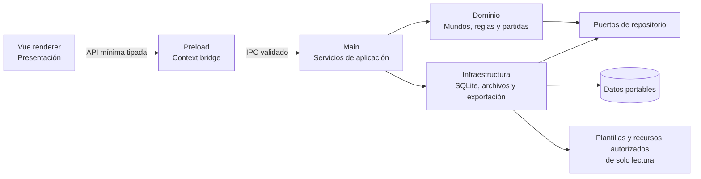

# Arquitectura de Fatebound 2.0

Estado del documento: propuesta arquitectónica sobre el scaffold existente.

Última actualización: 2026-10-10.

Este documento describe la dirección aprobada para Fatebound y marca expresamente lo que todavía no existe. No define un esquema SQL ni implica que los subsistemas propuestos estén implementados.

## 1. Punto de partida real

El repositorio contiene actualmente:

- un proceso main que crea una ventana, gestiona el ciclo de vida básico y responde al evento de demostración `ping`;
- un preload que expone `@electron-toolkit/preload` y un objeto `api` vacío;
- un renderer Vue con la pantalla de demostración de electron-vite;
- TypeScript estricto, ESLint, Prettier, electron-vite y electron-builder;
- recursos de marca y 36 imágenes de combinaciones de dados para los clanes de Ronin;
- una configuración de Windows basada en NSIS, no una distribución portable;
- un único perfil de empaquetado que todavía no separa artefactos públicos y privados.

No están implementados SQLite, el resolvedor de rutas portables, el dominio, el importador, el editor, el motor de reglas, las campañas, las crónicas ni la integración de IA.

## 2. Principios

- **Local primero:** jugar no requiere servidor ni conexión a Internet.
- **Portable:** los datos mutables se resuelven junto a la distribución portable y pueden viajar con ella.
- **Fronteras explícitas:** renderer, preload, main, dominio e infraestructura tienen responsabilidades separadas.
- **Contenido no confiable:** Markdown, metadatos e imágenes importados son datos que deben validarse; nunca se ejecutan.
- **Distribución responsable:** la compilación pública puede funcionar sin mundos y no incorpora contenido protegido de terceros sin autorización.
- **Versiones inmutables:** una versión publicada no se edita; una modificación genera una versión derivada.
- **Trazabilidad:** las acciones relevantes de una partida producen eventos utilizables en una crónica.
- **Control del jugador:** una IA opcional puede proponer, pero no modificar reglas ni estado de juego sin confirmación.

## 3. Capas propuestas



### 3.1 Renderer — presentación

Vue representa vistas, formularios y estados de interacción. Puede solicitar operaciones mediante la API del preload, pero no conoce rutas físicas, consultas SQL ni módulos de Node. Las respuestas que recibe son DTO tipados y sin detalles internos innecesarios.

### 3.2 Preload — frontera nativa

El preload expone una superficie pequeña agrupada por capacidades, por ejemplo mundos, campañas, crónicas y exportación. Cada llamada tiene tipos compartidos y límites claros. No se expondrán `ipcRenderer`, identificadores de canal arbitrarios ni primitivas generales de archivos.

### 3.3 Main — aplicación

El proceso main es dueño de:

- resolución de rutas;
- validación de solicitudes IPC;
- casos de uso y transacciones;
- conexión a SQLite;
- lectura y escritura de archivos;
- importación, exportación y copias de seguridad;
- coordinación del motor de reglas.

Los handlers IPC delegan en servicios de aplicación; no contienen reglas de negocio ni consultas dispersas.

### 3.4 Dominio

El dominio modelará mundos, versiones, técnicas, efectos, personajes, clanes, campañas y eventos sin depender de Electron, Vue o SQLite. Sus invariantes incluyen la inmutabilidad de versiones publicadas y la asociación de cada personaje y campaña a una versión concreta de mundo.

### 3.5 Infraestructura

Adaptadores concretos implementarán repositorios SQLite, almacenes de recursos, importación Markdown y exportación. Las dependencias apuntan hacia contratos del dominio o la aplicación, de modo que puedan probarse sin abrir una ventana de Electron.

Todas las subsecciones 3.1 a 3.5 describen el objetivo; salvo la separación física inicial de procesos, todavía no están implementadas.

## 4. Datos portables y SQLite

### 4.1 Resolución de rutas

**Propuesta no implementada:** un único servicio del proceso main resolverá las ubicaciones. Ningún consumidor construirá rutas absolutas ni dependerá de la letra de una unidad.

- En desarrollo, el directorio mutable se resolverá desde una raíz conocida del proyecto, con una ubicación ignorada por Git.
- En una distribución portable, la raíz se resolverá desde la ubicación que el launcher portable proporcione para el ejecutable, no desde el directorio temporal de extracción.
- Los datos mutables vivirán fuera de `app.asar` y de los recursos integrados.
- Si la ubicación no es escribible, la aplicación fallará de forma segura e informará al jugador; no cambiará silenciosamente a una carpeta de otro equipo.

La estructura conceptual será equivalente a:

```text
<raíz-portable>/
  data/          SQLite y estado administrado
  worlds/        recursos de mundos y versiones externas
  exports/       crónicas exportadas
  backups/       copias de seguridad recuperables
```

Los nombres exactos y la política de copias se aprobarán antes de implementarlos.

### 4.2 SQLite

**Propuesta no implementada:** SQLite será el almacén principal y su conexión pertenecerá exclusivamente al proceso main. La ubicación de la base de datos procederá del resolvedor portable.

La persistencia cubrirá los conceptos de mundos, versiones, traducciones, tablas de contenido, técnicas, efectos, personajes, clanes, campañas y eventos. Esto no define aún tablas ni un esquema físico.

Se requieren:

- migraciones ordenadas y transaccionales;
- verificación de versión al abrir;
- copias de seguridad antes de migraciones destructivas;
- recuperación explícita ante corrupción o extracción insegura de la unidad;
- restricciones que impidan modificar contenido publicado;
- operaciones idempotentes para registrar mundos importados e instalar contenido autorizado por el perfil de compilación.

La modalidad de journal de SQLite se decidirá después de probar su comportamiento en unidades extraíbles; no se presupone WAL.

## 5. Mundos, versiones y recursos

Un mundo es una línea de contenido independiente. Cada versión contiene datos, reglas declarativas, textos, traducciones y referencias a recursos. Los borradores pueden editarse; al publicarse se vuelven inmutables. Editar contenido publicado crea una versión nueva enlazada con su origen.

Las reglas, el contenido del mundo y el estado de las partidas se almacenan como responsabilidades diferentes:

- **reglas y efectos:** primitivas mecánicas estructuradas que puede ejecutar el motor;
- **datos del mundo:** clanes, técnicas, textos, tablas, traducciones y recursos de una versión;
- **partida:** personaje, campaña, decisiones, tiradas, consecuencias, notas y eventos.

Personajes y campañas conservan el identificador exacto de la versión del mundo con la que fueron creados. Una actualización del mundo no migra una partida de forma implícita.

### 5.1 Recursos incluidos y perfiles de distribución

Los recursos distribuidos con la aplicación permanecen en el paquete como fuente de solo lectura. `resources/branding/` contiene la marca. `resources/worlds/ronin/clans/` contiene actualmente las imágenes existentes `1_1.png` a `6_6.png`; esos nombres y archivos no se alteran en esta fase, pero su presencia en el repositorio no autoriza su inclusión automática en un artefacto público.

**Propuesta no implementada:** cada perfil de compilación utilizará una lista explícita de contenido autorizado y un manifiesto versionado con sus recursos y sumas de comprobación. La compilación pública incluirá únicamente recursos propios o autorizados y podrá no contener ningún mundo. Una compilación privada podrá añadir contenido preinstalado permitido sin cambiar las garantías del producto. Nunca se escribirá sobre una copia incluida.

Los artefactos públicos y privados tendrán nombres y procesos de salida inequívocos, y se verificará su contenido antes de distribuirlos. No se utilizarán contraseñas, cifrado superficial u ocultación como mecanismo para resolver permisos de licencia.

### 5.2 Recursos de mundos adicionales

**Propuesta no implementada:** al importar un mundo, sus archivos válidos se copiarán a un espacio administrado bajo la raíz portable, aislado por identificador de mundo y de versión. La base de datos guardará referencias relativas, nunca rutas absolutas del equipo de origen.

El importador impedirá escapes de directorio, enlaces inseguros, extensiones no admitidas y archivos que excedan los límites configurados. La publicación congelará las referencias de esa versión; una sustitución de recursos creará otra versión.

## 6. Ronin como mundo instalable

Ronin, de Tiago Junges, no es un requisito para ejecutar Fatebound. Se contemplan tres escenarios separados:

1. **Distribución pública:** no incorpora Ronin ni necesita ningún mundo preinstalado.
2. **Importación personal:** el usuario importa su propia copia de Ronin mediante el flujo normal de mundos.
3. **Compilación privada:** una variante separada puede llevar Ronin preinstalado cuando existan los permisos aplicables; no se publica ni se confunde con el artefacto público.

**Propuesta no implementada:** una vez instalado, Ronin se marcará como mundo protegido. El gestor ordinario no permitirá borrarlo accidentalmente; cualquier futura operación administrativa deberá ser explícita, advertida y recuperable. La versión instalada se conservará inmutable y una personalización creará una versión derivada sin sobrescribirla.

El registro de un Ronin importado y la instalación desde una compilación privada reutilizarán las mismas validaciones, el mismo modelo de versiones y transacciones idempotentes. Ninguno reemplazará partidas ni versiones modificadas por el usuario.

Actualmente solo existen los recursos gráficos indicados; no se ha importado el reglamento ni se ha instalado contenido de Ronin en SQLite. Las condiciones de licencia y atribución deberán resolverse para cualquier compilación que lo preinstale. Una contraseña no modifica esas condiciones y no forma parte del diseño.

## 7. Importador Markdown y editor

**Propuesta no implementada:** el formato de intercambio combinará Markdown legible con metadatos estructurados y versionados. Fatebound incluirá plantillas y ejemplos originales, sin textos, tablas ni reglas copiadas de Ronin o de otros terceros.

Las futuras plantillas deberán documentar, como requisitos mínimos:

- identificadores estables y relaciones entre elementos;
- metadatos del mundo y de sus versiones;
- tablas y resultados de dados;
- textos traducibles y asociación de traducciones;
- efectos mecánicos, parámetros y condiciones;
- referencias relativas a imágenes y otros recursos.

El mismo modelo deberá poder importarse, validarse, editarse y exportarse sin pérdida de información. El contrato exacto —sintaxis, esquema, organización de archivos, manifiestos y estrategia de versiones— se diseñará en una tarea posterior; este documento no lo fija todavía.

El flujo previsto es:

1. seleccionar un paquete o documento y copiarlo a un área temporal controlada;
2. analizar metadatos y Markdown sin ejecutar scripts;
3. validar esquema, referencias, tamaños y tipos de recursos;
4. mostrar errores y una vista previa normalizada;
5. crear un borrador editable;
6. publicar una versión inmutable mediante una transacción.

El editor modifica borradores o crea una versión derivada. El texto natural explica ambientación y reglas a las personas, pero no se convierte ni evalúa como código. HTML activo, JavaScript y rutas remotas no se consideran confiables.

## 8. Motor de reglas y efectos

**Propuesta no implementada:** el motor recibe acciones estructuradas y produce resultados deterministas a partir del estado, los efectos y las tiradas proporcionadas. No analiza prosa para decidir mecánicas.

Las técnicas referenciarán un catálogo versionado de efectos mecánicos reutilizables. Cada efecto tendrá un identificador conocido, parámetros validados y una implementación explícita. Componer técnicas significa combinar efectos admitidos, no evaluar expresiones arbitrarias ni cargar módulos desde un mundo importado.

El generador de tiradas se abstraerá para permitir reproducción y pruebas. Las entradas y salidas relevantes producirán eventos de campaña.

## 9. Personajes, clanes y campañas

**Propuesta no implementada:** un personaje pertenece a una versión concreta de mundo y puede referenciar un clan definido en esa misma versión. Una campaña conserva su mundo, versión, participantes, estado y secuencia de eventos.

Los casos de uso validarán que las referencias pertenezcan a la misma versión. La actualización o publicación de un mundo no alterará automáticamente personajes o campañas existentes; una migración futura deberá ser explícita, reversible y confirmada.

## 10. Eventos y crónicas

**Propuesta no implementada:** toda partida registrará una secuencia ordenada de acontecimientos, decisiones, tiradas, consecuencias y notas. Un evento tendrá datos estructurados para reconstrucción y una representación legible para la crónica.

La exportación a Markdown será un caso de uso del proceso main. Generará un archivo legible desde una instantánea coherente de la campaña y utilizará rutas resueltas por el usuario o por el almacenamiento portable. Exportar no modificará la partida.

Debe definirse qué correcciones se representan como nuevos eventos y cuáles pueden editarse como notas, conservando la trazabilidad del resultado mecánico.

## 11. IA opcional

**Propuesta futura y no implementada:** la IA será un adaptador opcional, no una dependencia del dominio ni del flujo básico de juego. Fatebound debe iniciar, jugar, guardar y exportar sin red ni proveedor de IA.

La IA podrá sugerir texto, resúmenes o alternativas a partir de contexto autorizado. Sus respuestas serán propuestas visibles que requieren intervención del jugador. No podrá modificar reglas publicadas, resolver mecánicas por fuera del motor ni escribir eventos o datos persistentes sin confirmación.

El proveedor, el procesamiento local o remoto y las reglas de privacidad siguen pendientes de decisión.

## 12. Seguridad y estabilidad

La implementación deberá:

- mantener `contextIsolation` y aspirar a ejecutar el renderer con sandbox;
- validar en main tanto solicitudes como datos importados;
- usar canales IPC declarados, DTO limitados y errores sanitizados;
- impedir acceso directo del renderer a Node, archivos y SQLite;
- sanitizar el Markdown renderizado y bloquear contenido activo;
- verificar rutas mediante resolución y contención antes de leer o escribir;
- escribir de forma transaccional o atómica cuando corresponda;
- no confiar en nombres, extensiones, MIME ni rutas proporcionados por un paquete;
- conservar copias recuperables antes de migraciones y operaciones destructivas;
- registrar errores técnicos sin exponer datos privados en la interfaz.

El preload genérico y `sandbox: false` del scaffold actual son brechas conocidas, no el diseño de seguridad final.

## 13. Orden de implementación recomendado

1. Resolver y probar la raíz portable en desarrollo y distribución Windows.
2. Definir contratos IPC mínimos y endurecer la ventana.
3. Introducir SQLite, migraciones y repositorios sin contenido de juego.
4. Diseñar el formato de mundos y sus plantillas originales.
5. Incorporar importación, validación, edición, exportación y publicación inmutable.
6. Implementar motor, campañas, eventos y exportación.
7. Separar y verificar los perfiles de compilación pública y privada.
8. Añadir interfaces finales e integración opcional de IA.

`STATUS.md` es la fuente para la prioridad inmediata y el resultado real de cada fase.
