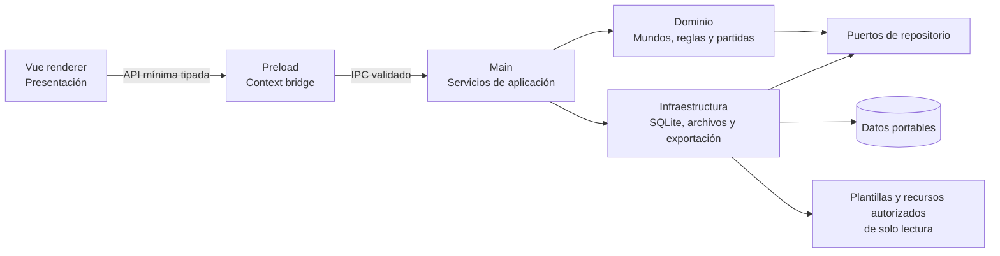

# Arquitectura de Fatebound 2.0

Estado del documento: arquitectura propuesta con el resolvedor, SQLite inicial y el empaquetado portable de Windows ya implementados.

Última actualización: 2026-10-10.

Este documento describe la dirección aprobada para Fatebound y marca expresamente lo que todavía no existe. La única tabla actual controla migraciones; no se ha definido el esquema SQL del juego ni se consideran implementados los demás subsistemas propuestos.

## 1. Punto de partida real

El repositorio contiene actualmente:

- un proceso main que crea una ventana, gestiona el ciclo de vida básico y responde al evento de demostración `ping`;
- un preload que expone `@electron-toolkit/preload` y un objeto `api` vacío;
- un renderer Vue con la pantalla de demostración de electron-vite;
- TypeScript estricto, ESLint, Prettier, electron-vite y electron-builder;
- recursos de marca y 36 imágenes de combinaciones de dados para los clanes de Ronin;
- un target `portable` x64 de electron-builder que genera `dist/Fatebound.exe` sin instalador obligatorio;
- un empaquetado público con lista explícita de recursos propios; la variante privada todavía no está configurada;
- un resolvedor central, una comprobación de escritura y una conexión SQLite ejecutados en main antes de crear la ventana principal;
- migraciones SQL versionadas y transaccionales con una única migración técnica inicial.

No están implementados el esquema de persistencia del juego, los repositorios del dominio, el importador, el editor, el motor de reglas, las campañas, las crónicas ni la integración de IA.

## 2. Principios

- **Local primero:** jugar no requiere servidor ni conexión a Internet.
- **Portable:** los datos mutables se resuelven junto a la distribución portable y pueden viajar con ella.
- **Fronteras explícitas:** renderer, preload, main, dominio e infraestructura tienen responsabilidades separadas.
- **Contenido no confiable:** Markdown, metadatos e imágenes importados son datos que deben validarse; nunca se ejecutan.
- **Distribución responsable:** la compilación pública puede funcionar sin mundos y no incorpora contenido protegido de terceros sin autorización.
- **Versiones inmutables:** una versión publicada no se edita; una modificación genera una versión derivada.
- **Trazabilidad:** las acciones relevantes de una partida producen eventos utilizables en una crónica.
- **Control del jugador:** una IA opcional puede proponer, pero no modificar reglas ni estado de juego sin confirmación.

## 3. Capas propuestas



### 3.1 Renderer — presentación

Vue representa vistas, formularios y estados de interacción. Puede solicitar operaciones mediante la API del preload, pero no conoce rutas físicas, consultas SQL ni módulos de Node. Las respuestas que recibe son DTO tipados y sin detalles internos innecesarios.

### 3.2 Preload — frontera nativa

El preload expone una superficie pequeña agrupada por capacidades, por ejemplo mundos, campañas, crónicas y exportación. Cada llamada tiene tipos compartidos y límites claros. No se expondrán `ipcRenderer`, identificadores de canal arbitrarios ni primitivas generales de archivos.

### 3.3 Main — aplicación

El proceso main ya es dueño de la resolución de rutas, la comprobación de escritura, la conexión SQLite, sus migraciones, su cierre y el flujo nativo de recuperación. También será dueño de:

- validación de solicitudes IPC;
- casos de uso y transacciones;
- lectura y escritura de archivos;
- importación, exportación y copias de seguridad;
- coordinación del motor de reglas.

Los handlers IPC delegan en servicios de aplicación; no contienen reglas de negocio ni consultas dispersas.

### 3.4 Dominio

El dominio modelará mundos, versiones, técnicas, efectos, personajes, clanes, campañas y eventos sin depender de Electron, Vue o SQLite. Sus invariantes incluyen la inmutabilidad de versiones publicadas y la asociación de cada personaje y campaña a una versión concreta de mundo.

### 3.5 Infraestructura

La infraestructura inicial implementa el ciclo de vida de SQLite y sus migraciones sin depender del renderer. Adaptadores concretos implementarán repositorios SQLite, almacenes de recursos, importación Markdown y exportación. Las dependencias apuntan hacia contratos del dominio o la aplicación, de modo que puedan probarse sin abrir una ventana de Electron.

Las capas de dominio y repositorios continúan siendo propuestas. La frontera de procesos, el resolvedor portable, la validación previa de escritura y la base SQLite inicial ya están implementados.

## 4. Datos portables y SQLite

### 4.1 Resolución de rutas

**Implementado:** `src/main/storage/portable-storage.ts` es la fuente central de rutas. Recibe el contexto de ejecución y produce rutas absolutas resueltas en tiempo de ejecución, sin codificar una letra de unidad ni una ubicación específica de un ordenador.

- En desarrollo usa `<appPath>/.fatebound-dev/data/`, una ubicación local ignorada por Git e independiente de instalaciones reales.
- En una aplicación empaquetada prefiere el directorio indicado por `PORTABLE_EXECUTABLE_DIR`. El launcher portable de electron-builder establece esa variable con `$EXEDIR`, el directorio original de `Fatebound.exe`, antes de extraer y abrir la aplicación. Así, la ruta no depende del directorio temporal. Si la variable no existe, el resolvedor usa el directorio de `process.execPath`.
- En ambos casos los datos mutables viven fuera de `app.asar` y de los recursos integrados.
- Una carpeta elegida manualmente se convierte en la raíz de datos solo durante esa sesión; no se persiste, no se inspecciona en busca de datos anteriores y no provoca movimientos ni copias.

Las rutas centrales actuales son:

```text
<directorio-del-ejecutable-portable>/
  data/
    fatebound.sqlite   base creada o abierta durante el arranque
    worlds/            recursos importados futuros
    exports/           exportaciones futuras
    backups/           copias de seguridad futuras
```

La comprobación de permisos crea el directorio de datos si falta. Después, y solo si la ubicación es válida, SQLite crea o abre `fatebound.sqlite`. Los subdirectorios siguen siendo rutas reservadas para consumidores futuros y no se crean en esta fase.

### 4.2 Comprobación de escritura y recuperación

**Implementado:** antes de crear la ventana principal, main crea el directorio si falta e intenta escribir un archivo temporal exclusivo con un nombre aleatorio. Después elimina el archivo. Un fallo de escritura o de limpieza invalida la ubicación.

Si la prueba falla, un diálogo nativo ofrece exactamente:

- **Reintentar:** comprueba de nuevo la misma ubicación.
- **Elegir otra carpeta:** abre el selector del sistema, valida la carpeta elegida y la usa solo durante la sesión.
- **Salir:** termina la aplicación sin activar almacenamiento ni abrir la ventana Vue.

Cancelar el selector vuelve al diálogo de decisión. No existe fallback automático. La ventana principal se crea una sola vez y únicamente después de activar una ubicación válida, abrir SQLite y aplicar sus migraciones; los eventos de activación de Electron se ignoran mientras no haya una conexión abierta.

La orquestación está separada de Electron para poder probar reintentos, alternativas y salida con dobles controlados. La prueba de escritura real usa un directorio temporal del sistema y lo elimina al finalizar; ninguna prueba toca carpetas reales del usuario.

### 4.3 Distribución portable de Windows

**Implementado y verificado por construcción e inspección:** `electron-builder.yml` define un target `portable` x64 con identidad `com.fatebound.app`, nombre de producto y ejecutable `Fatebound`, y nivel de ejecución de usuario. `npm run build:win` produce `dist/Fatebound.exe`; no configura instalador obligatorio, publicación ni actualización automática.

El artefacto actual no tiene firma Authenticode. La identidad legal, el certificado y la custodia de sus credenciales deberán resolverse antes de una distribución pública firmada; no se incorporan secretos ni certificados al repositorio.

El ejecutable portable se autoextrae para ejecutar Electron, pero esa ubicación temporal no es la raíz de datos. La cadena comprobada es:

```text
Fatebound.exe en una carpeta cualquiera
  -> launcher: PORTABLE_EXECUTABLE_DIR = directorio original del ejecutable
  -> main: resolvePortableStoragePaths(...)
  -> <directorio original>/data/
```

La prueba automatizada usa directorios temporales controlados y confirma que `PORTABLE_EXECUTABLE_DIR` prevalece sobre un `process.execPath` que simula la extracción temporal. El argumento técnico `--verify-portable-sqlite` permite ejecutar el artefacto real en una carpeta temporal: abre la ruta portable, aplica migraciones, cierra la conexión y sale sin crear una ventana.

### 4.4 SQLite

**Implementado en su nivel inicial:** Fatebound usa `DatabaseSync` de `node:sqlite`, integrado en el Node 22 que distribuye Electron 39. Se ha preferido frente a un addon externo como `better-sqlite3` porque evita binarios `.node`, reconstrucciones ABI y configuración especial de `asar`, lo que reduce los puntos de fallo del portable. La contrapartida conocida es que Node 22 clasifica todavía esta API como desarrollo activo; por eso `package.json` exige Node 22.18 o posterior y la compatibilidad se valida también ejecutando el portable, no solo bajo Node de desarrollo.

`src/main/storage/sqlite-storage.ts` es el único propietario de la conexión activa. Recibe la ruta de `getActiveStoragePaths().databaseFile`, la resuelve sin sustituirla por una ubicación fija, configura SQLite y llama al migrador. Ni preload ni renderer exponen SQLite. Si la apertura, la configuración o una migración fallan, la conexión parcial se cierra, se muestra un error nativo y la ventana principal no se crea. La conexión normal se cierra de forma idempotente en `will-quit`.

La configuración inicial es deliberadamente conservadora para almacenamiento extraíble:

- `journal_mode=DELETE`: usa un rollback journal transitorio junto a la base y evita mantener los archivos `-wal` y `-shm` de WAL. Un journal interrumpido puede recuperarse al volver a abrir; nunca debe separarse ni borrarse manualmente.
- `synchronous=EXTRA`: añade a `FULL` la sincronización del directorio después de eliminar el rollback journal. Aumenta escrituras y latencia, pero prioriza durabilidad ante pérdida de alimentación o extracción inesperada.
- claves foráneas activas, extensiones cargables deshabilitadas, literales de cadena con comillas dobles deshabilitados y `trusted_schema=OFF`.
- `temp_store=MEMORY`, para que los temporales no transaccionales no dependan de la carpeta temporal del sistema, y un timeout de bloqueos de cinco segundos.

Esta configuración no puede garantizar durabilidad si el sistema operativo, el controlador o la propia unidad informan de una sincronización antes de persistir los datos, ni puede hacer segura la retirada física durante una escritura. Sigue pendiente probar una unidad extraíble real e implementar copias de seguridad, comprobaciones de integridad y recuperación explícita.

`src/main/storage/sqlite-migrations.ts` contiene un manifiesto ordenado de migraciones con versión, nombre y SQL. Al abrir se compara toda la historia aplicada con el manifiesto integrado; una versión futura, un hueco o un nombre distinto bloquean el arranque. Cada migración pendiente se ejecuta de forma independiente con `BEGIN IMMEDIATE`, registra su versión dentro de la misma transacción y termina con `COMMIT`; cualquier error ejecuta `ROLLBACK`.

La migración 1, `initialize_migration_tracking`, crea únicamente `fatebound_schema_migrations`, con versión, nombre y fecha de aplicación. No existen tablas de mundos, personajes, clanes, campañas, eventos ni contenido de Ronin. Las migraciones futuras deberán conservar el mismo orden, y antes de que alguna sea destructiva habrá que implementar la política de copias de seguridad.

Referencias técnicas de la decisión: [API `node:sqlite` de Node 22.20](https://nodejs.org/download/release/v22.20.0/docs/api/sqlite.html), [PRAGMA de SQLite](https://www.sqlite.org/pragma.html) y [archivos temporales y journals](https://www.sqlite.org/tempfiles.html).

## 5. Mundos, versiones y recursos

Un mundo es una línea de contenido independiente. Cada versión contiene datos, reglas declarativas, textos, traducciones y referencias a recursos. Los borradores pueden editarse; al publicarse se vuelven inmutables. Editar contenido publicado crea una versión nueva enlazada con su origen.

Las reglas, el contenido del mundo y el estado de las partidas se almacenan como responsabilidades diferentes:

- **reglas y efectos:** primitivas mecánicas estructuradas que puede ejecutar el motor;
- **datos del mundo:** clanes, técnicas, textos, tablas, traducciones y recursos de una versión;
- **partida:** personaje, campaña, decisiones, tiradas, consecuencias, notas y eventos.

Personajes y campañas conservan el identificador exacto de la versión del mundo con la que fueron creados. Una actualización del mundo no migra una partida de forma implícita.

### 5.1 Recursos incluidos y perfiles de distribución

Los recursos distribuidos con la aplicación permanecen en el paquete como fuente de solo lectura. El target público implementado usa `extraResources` con una lista explícita: incluye `resources/icon.png` y los siete archivos de `resources/branding/`, conservando nombres y rutas relativas bajo `process.resourcesPath/resources/`. La inspección del portable y la comparación de hashes confirmaron los ocho archivos.

`resources/worlds/ronin/clans/` conserva en el repositorio las imágenes existentes `1_1.png` a `6_6.png`, sin alteraciones, pero la lista pública las excluye y la inspección confirmó que no aparecen en `Fatebound.exe`.

**Propuesta no implementada:** una compilación privada podrá añadir contenido preinstalado permitido mediante un perfil separado y verificable, sin cambiar las garantías del producto. También queda pendiente definir un manifiesto versionado de recursos y sumas de comprobación. Nunca se escribirá sobre una copia incluida.

Los artefactos públicos y privados tendrán nombres y procesos de salida inequívocos, y se verificará su contenido antes de distribuirlos. No se utilizarán contraseñas, cifrado superficial u ocultación como mecanismo para resolver permisos de licencia.

### 5.2 Recursos de mundos adicionales

**Propuesta no implementada:** al importar un mundo, sus archivos válidos se copiarán a un espacio administrado bajo la raíz portable, aislado por identificador de mundo y de versión. La base de datos guardará referencias relativas, nunca rutas absolutas del equipo de origen.

El importador impedirá escapes de directorio, enlaces inseguros, extensiones no admitidas y archivos que excedan los límites configurados. La publicación congelará las referencias de esa versión; una sustitución de recursos creará otra versión.

## 6. Ronin como mundo instalable

Ronin, de Tiago Junges, no es un requisito para ejecutar Fatebound. Se contemplan tres escenarios separados:

1. **Distribución pública:** no incorpora Ronin ni necesita ningún mundo preinstalado.
2. **Importación personal:** el usuario importa su propia copia de Ronin mediante el flujo normal de mundos.
3. **Compilación privada:** una variante separada puede llevar Ronin preinstalado cuando existan los permisos aplicables; no se publica ni se confunde con el artefacto público.

**Propuesta no implementada:** una vez instalado, Ronin se marcará como mundo protegido. El gestor ordinario no permitirá borrarlo accidentalmente; cualquier futura operación administrativa deberá ser explícita, advertida y recuperable. La versión instalada se conservará inmutable y una personalización creará una versión derivada sin sobrescribirla.

El registro de un Ronin importado y la instalación desde una compilación privada reutilizarán las mismas validaciones, el mismo modelo de versiones y transacciones idempotentes. Ninguno reemplazará partidas ni versiones modificadas por el usuario.

Actualmente solo existen los recursos gráficos indicados; no se ha importado el reglamento ni se ha instalado contenido de Ronin en SQLite. Las condiciones de licencia y atribución deberán resolverse para cualquier compilación que lo preinstale. Una contraseña no modifica esas condiciones y no forma parte del diseño.

## 7. Importador Markdown y editor

**Propuesta no implementada:** el formato de intercambio combinará Markdown legible con metadatos estructurados y versionados. Fatebound incluirá plantillas y ejemplos originales, sin textos, tablas ni reglas copiadas de Ronin o de otros terceros.

Las futuras plantillas deberán documentar, como requisitos mínimos:

- identificadores estables y relaciones entre elementos;
- metadatos del mundo y de sus versiones;
- tablas y resultados de dados;
- textos traducibles y asociación de traducciones;
- efectos mecánicos, parámetros y condiciones;
- referencias relativas a imágenes y otros recursos.

El mismo modelo deberá poder importarse, validarse, editarse y exportarse sin pérdida de información. El contrato exacto —sintaxis, esquema, organización de archivos, manifiestos y estrategia de versiones— se diseñará en una tarea posterior; este documento no lo fija todavía.

El flujo previsto es:

1. seleccionar un paquete o documento y copiarlo a un área temporal controlada;
2. analizar metadatos y Markdown sin ejecutar scripts;
3. validar esquema, referencias, tamaños y tipos de recursos;
4. mostrar errores y una vista previa normalizada;
5. crear un borrador editable;
6. publicar una versión inmutable mediante una transacción.

El editor modifica borradores o crea una versión derivada. El texto natural explica ambientación y reglas a las personas, pero no se convierte ni evalúa como código. HTML activo, JavaScript y rutas remotas no se consideran confiables.

## 8. Motor de reglas y efectos

**Propuesta no implementada:** el motor recibe acciones estructuradas y produce resultados deterministas a partir del estado, los efectos y las tiradas proporcionadas. No analiza prosa para decidir mecánicas.

Las técnicas referenciarán un catálogo versionado de efectos mecánicos reutilizables. Cada efecto tendrá un identificador conocido, parámetros validados y una implementación explícita. Componer técnicas significa combinar efectos admitidos, no evaluar expresiones arbitrarias ni cargar módulos desde un mundo importado.

El generador de tiradas se abstraerá para permitir reproducción y pruebas. Las entradas y salidas relevantes producirán eventos de campaña.

## 9. Personajes, clanes y campañas

**Propuesta no implementada:** un personaje pertenece a una versión concreta de mundo y puede referenciar un clan definido en esa misma versión. Una campaña conserva su mundo, versión, participantes, estado y secuencia de eventos.

Los casos de uso validarán que las referencias pertenezcan a la misma versión. La actualización o publicación de un mundo no alterará automáticamente personajes o campañas existentes; una migración futura deberá ser explícita, reversible y confirmada.

## 10. Eventos y crónicas

**Propuesta no implementada:** toda partida registrará una secuencia ordenada de acontecimientos, decisiones, tiradas, consecuencias y notas. Un evento tendrá datos estructurados para reconstrucción y una representación legible para la crónica.

La exportación a Markdown será un caso de uso del proceso main. Generará un archivo legible desde una instantánea coherente de la campaña y utilizará rutas resueltas por el usuario o por el almacenamiento portable. Exportar no modificará la partida.

Debe definirse qué correcciones se representan como nuevos eventos y cuáles pueden editarse como notas, conservando la trazabilidad del resultado mecánico.

## 11. IA opcional

**Propuesta futura y no implementada:** la IA será un adaptador opcional, no una dependencia del dominio ni del flujo básico de juego. Fatebound debe iniciar, jugar, guardar y exportar sin red ni proveedor de IA.

La IA podrá sugerir texto, resúmenes o alternativas a partir de contexto autorizado. Sus respuestas serán propuestas visibles que requieren intervención del jugador. No podrá modificar reglas publicadas, resolver mecánicas por fuera del motor ni escribir eventos o datos persistentes sin confirmación.

El proveedor, el procesamiento local o remoto y las reglas de privacidad siguen pendientes de decisión.

## 12. Seguridad y estabilidad

La implementación deberá:

- mantener `contextIsolation` y aspirar a ejecutar el renderer con sandbox;
- validar en main tanto solicitudes como datos importados;
- usar canales IPC declarados, DTO limitados y errores sanitizados;
- impedir acceso directo del renderer a Node, archivos y SQLite;
- sanitizar el Markdown renderizado y bloquear contenido activo;
- verificar rutas mediante resolución y contención antes de leer o escribir;
- escribir de forma transaccional o atómica cuando corresponda;
- no confiar en nombres, extensiones, MIME ni rutas proporcionados por un paquete;
- conservar copias recuperables antes de migraciones y operaciones destructivas;
- registrar errores técnicos sin exponer datos privados en la interfaz.

El preload genérico y `sandbox: false` del scaffold actual son brechas conocidas, no el diseño de seguridad final.

## 13. Orden de implementación recomendado

1. **Implementado:** resolver y probar la raíz de datos portable y el flujo ante falta de escritura.
2. **Implementado y validado:** generar el portable de Windows y validar su comportamiento en ejecución.
3. Definir contratos IPC mínimos y endurecer la ventana.
4. **Implementado parcialmente:** introducir SQLite y migraciones sin contenido de juego; siguen pendientes los repositorios.
5. Diseñar el formato de mundos y sus plantillas originales.
6. Incorporar importación, validación, edición, exportación y publicación inmutable.
7. Implementar motor, campañas, eventos y exportación.
8. Configurar y verificar el perfil privado separado cuando exista autorización para su contenido.
9. Añadir interfaces finales e integración opcional de IA.

`STATUS.md` es la fuente para la prioridad inmediata y el resultado real de cada fase.
